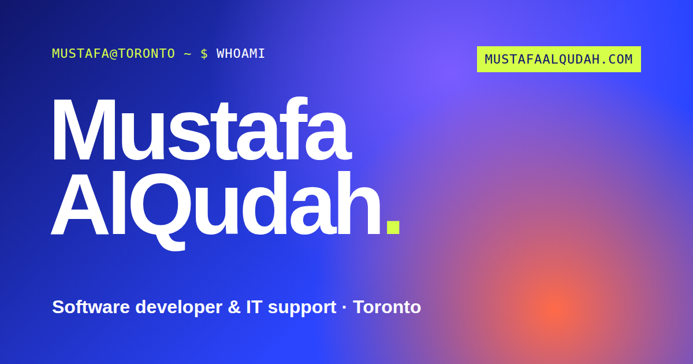

# mustafaalqudah.com

My portfolio, hand-written in one HTML file with no framework and no build step.

**Live:** [mustafaalqudah.com](https://mustafaalqudah.com)



## What's in it

- **WebGL flow field** behind the page: a fragment shader drawing a moving field, with a few thousand particles that form my name. Move the cursor through it and it parts; click and it scatters.
- **A hidden terminal.** Press <kbd>`</kbd> (or the terminal button) and type `help`. The commands are `whoami`, `ls`, `projects`, `skills`, `resume`, `contact` and `clear`.
- **Work:** CodeIt, LYNQ Office and the LYNQ studio, live client sites, AI video and reels, experience and education.
- **Two résumés** (software developer and IT support) in [`resume/`](resume).
- **Accessible and fast:** semantic HTML, keyboard-friendly, `prefers-reduced-motion` turns off the motion, fonts are self-hosted, images are WebP and video is lazy.

## Files

```
index.html     the whole site: markup, styles and scripts
fonts/         Bricolage Grotesque, Geist, Geist Mono (self-hosted)
img/           project thumbnails (WebP)
video/         short screen recordings of client sites, with posters
resume/        résumés (PDF)
_headers       security and cache headers
og.png         social preview
```

## Run it

Open `index.html` in a browser, or serve the folder:

```bash
python3 -m http.server 8000
```

## License

The code is MIT (see [LICENSE](LICENSE)). The résumés, photos and video belong to me and to the clients shown, and are not covered by the licence.
